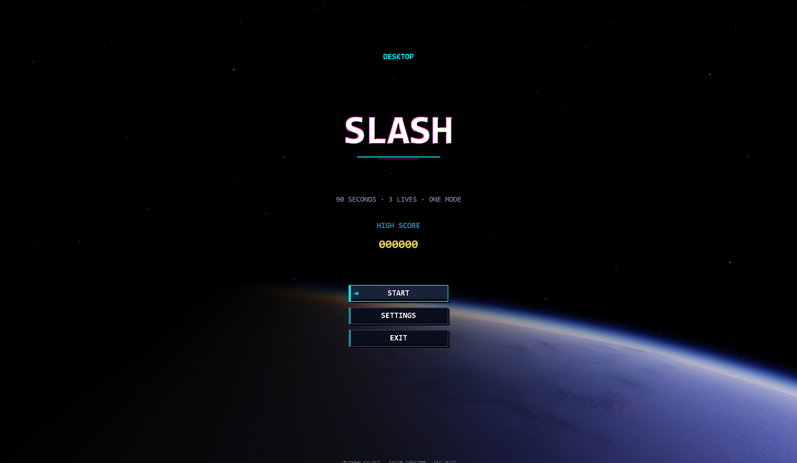
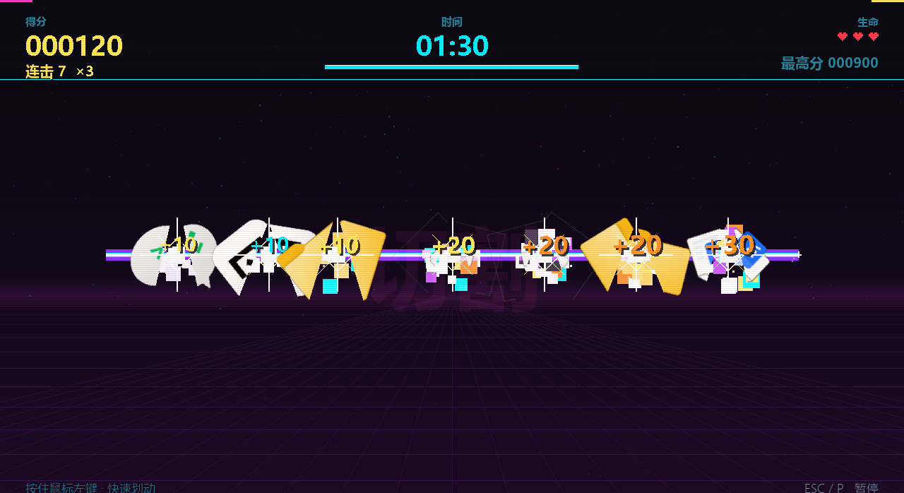
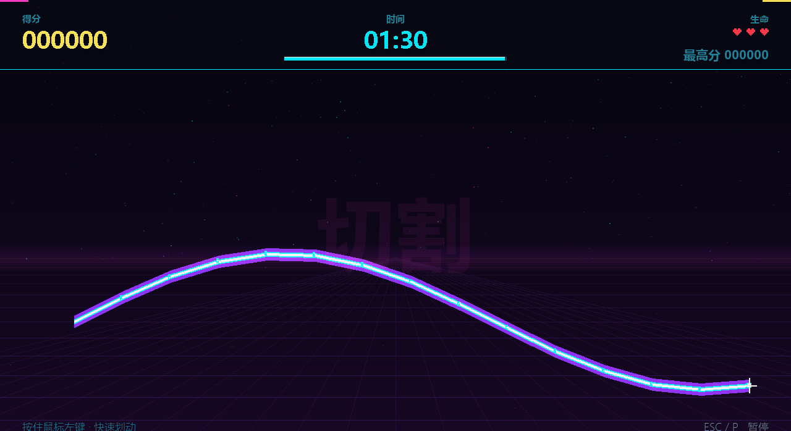
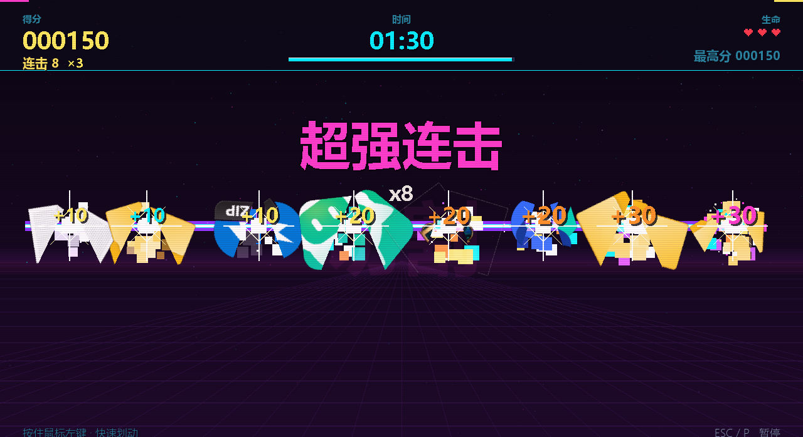
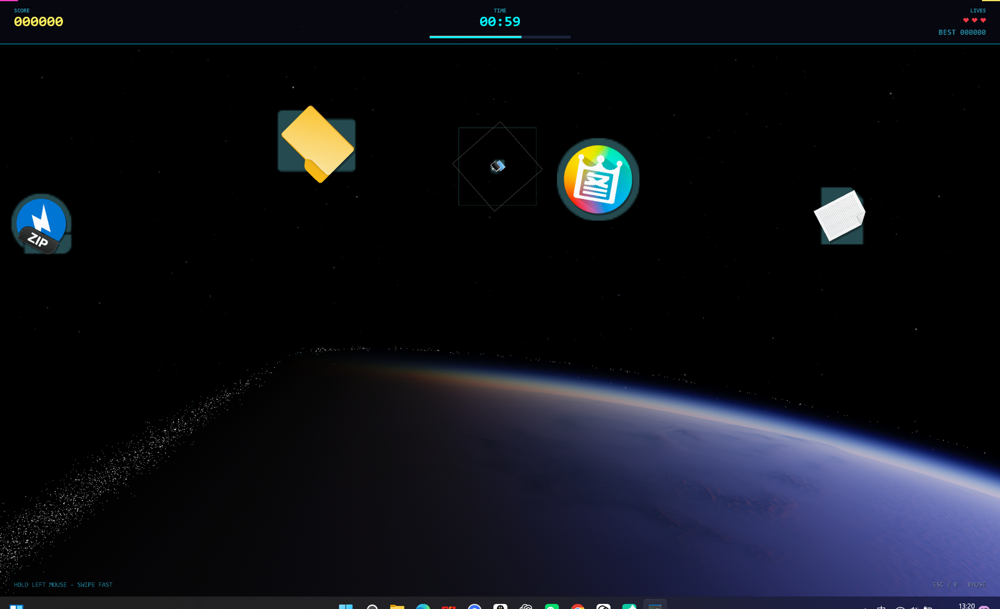

<div align="center">

# Desktop Slash

**把 Windows 桌面变成一场街机切割游戏。**

你的桌面图标会飞起来，用鼠标划过去把它们切开。




</div>

## 简介

Desktop Slash 不是窗口里的游戏。启动后，它会在桌面上铺一层透明覆盖层，读取你**真实的桌面图标**，临时隐藏图标本体，同时保留你的壁纸和任务栏。成批图标从屏幕底部飞起，按住左键快速划动即可把它们切成两半。

退出时会自动恢复桌面图标——不管是正常退出、异常崩溃，还是看门狗兜底。游戏不会移动、删除或重命名任何桌面文件。

## 特性

- **真实图标** — 通过 Windows Shell 读取 256 px 图标，而不是内置素材包
- **桌面即场地** — 透明无边框覆盖层，壁纸与任务栏保持原样
- **街机玩法** — 90 秒一局、3 条命、连击倍率、炸弹
- **手感反馈** — 刀光轨迹、碎片、粒子、飘分、震屏、扫描线
- **中英双语** — 设置里即时切换，无需重启
- **安全退出** — 统一退出流程 + 看门狗，崩溃后也能恢复图标
- **不抢焦点** — 切到其他应用自动暂停并释放鼠标，不会把你强行拉回游戏

## 游戏画面

<table>
  <tr>
    <td width="50%"></td>
    <td width="50%"></td>
  </tr>
  <tr>
    <td align="center"><sub>划动切割，图标分裂并飘出得分</sub></td>
    <td align="center"><sub>刀光轨迹与拖尾</sub></td>
  </tr>
  <tr>
    <td width="50%"></td>
    <td width="50%"></td>
  </tr>
  <tr>
    <td align="center"><sub>连击倍率与碎片特效</sub></td>
    <td align="center"><sub>真实桌面：壁纸、任务栏与飞起的图标</sub></td>
  </tr>
</table>

## 环境要求

| 项目 | 要求 |
| --- | --- |
| 系统 | Windows 10 / 11，x64 |
| Python | 3.11 或更高（开发与验证使用 3.11.2） |
| 依赖 | pygame 2.6.x、Pillow 10+、pywin32 |

## 快速开始

```bash
git clone https://github.com/oioonooio/DeskSlash.git
cd DeskSlash

py -3.11 -m venv .venv
.venv\Scripts\activate
pip install -r requirements.txt

python main.py --overlay
```

启动后桌面图标会被临时隐藏，壁纸保持不变；退出时恢复。

可用参数：

| 参数 | 作用 |
| --- | --- |
| `--overlay` | 桌面覆盖层模式（推荐） |
| `--window` | 普通窗口模式，便于调试 |
| `--monitor N` | 指定显示器 |
| `--self-test` | 运行内置自检后退出 |

## 操作

| 操作 | 按键 |
| --- | --- |
| 移动刀锋 | 鼠标移动 |
| 切割 | 按住鼠标左键快速划动（≥ 420 px/s） |
| 暂停 / 继续 | `Esc` 或 `P` |
| 菜单选择 / 确认 | `↑` `↓` / `Enter` |
| 暂停时返回主菜单 | `M` |
| 暂停时退出 | `Q` |
| 紧急退出（任意状态） | `Ctrl + Shift + Q` |

暂停只释放鼠标，不恢复桌面图标；切出游戏再切回来也不会自动继续。

## 玩法

- 每局 **90 秒**，初始 **3 条命**。
- 切中图标得 **10 分 × 连击倍率**，连击间隔 1.7 秒内继续切中即可累积，倍率最高 ×5。
- 漏掉图标或切到炸弹扣 1 条命，连击清零。
- 炸弹在开局 6 秒后出现，随时间越来越密集。
- 时间耗尽或生命归零时结算，最高分自动保存。

## 技术实现

- **透明覆盖层**：`WS_EX_LAYERED + LWA_COLORKEY`，键色 `(1, 0, 2)` 全透明，桌面只留下游戏对象
- **鼠标接管**：一个近乎不可见的输入盾窗转发鼠标消息；暂停时切换为 `WS_EX_TRANSPARENT`，桌面可正常操作
- **图标读取**：`IShellItemImageFactory` 获取 256 px 图标，等比缩放并保留透明通道
- **桌面隐藏**：校验 `SysListView32` 属主为 `explorer.exe` 后 `ShowWindow(SW_HIDE)`；恢复前写标记文件，正常退出、异常、`atexit` 与看门狗均可恢复
- **焦点管理**：`FocusManager` 综合 SDL 焦点事件、`WM_ACTIVATE` 与 0.2 秒 `GetForegroundWindow` 轮询；后台降到 15 FPS，从不调用 `SetForegroundWindow` 抢焦点
- **统一退出**：`SHUTTING_DOWN → RESTORING_DESKTOP → DESTROYING_WINDOWS → RELEASING_RESOURCES → STOPPED`，5 秒预算，单步失败不中断

## 项目结构

```
DesktopSlash/
├─ main.py                 # 入口与命令行参数
├─ game_config.py          # 全部可调参数
├─ core/                   # 主循环、状态机、焦点、存档、退出
├─ desktop/                # 桌面图标读取、壁纸、隐藏与恢复
├─ gameplay/               # 图标生成、切割检测、炸弹、连击
├─ physics/                # 抛射与阻尼
├─ effects/                # 刀光、碎片、粒子、飘分
├─ ui/                     # 菜单、HUD、设置、字体
├─ window/                 # 覆盖层、输入盾窗、窗口管理
├─ localization/           # 中英文翻译
├─ audio/                  # 代码合成音效
├─ assets/                 # 图标资源
├─ docs/images/            # README 截图
├─ test_*.py               # 自动化与实机测试
└─ DesktopSlash.spec       # PyInstaller 打包配置
```

## 测试

```bash
python test_focus.py             # 焦点状态机（无头）
python test_gameplay.py          # 切割与得分
python test_effects.py           # 特效
python test_i18n.py              # 中英切换
python test_shutdown.py          # 退出流程
python test_desktop_background.py
```

需要真实桌面的测试会接管鼠标和前台窗口，请在空闲时运行：

```bash
python test_focus_live.py --cycles 4
python test_focus_live.py --cycles 20 --no-screens
```

## 打包

```bat
build_exe.bat
```

生成 `dist\DesktopSlash.exe`（单文件、无控制台），并自动运行 `--self-test` 自检。

## 数据与日志

| 内容 | 路径 |
| --- | --- |
| 存档与设置 | `%APPDATA%\DesktopSlash\save.json` |
| 运行日志 | `%APPDATA%\DesktopSlash\desktop_slash.log` |
| 桌面恢复记录 | `%APPDATA%\DesktopSlash\desktop_restore.log` |

所有用户数据都在仓库之外，不会被提交。

## 已知限制

- 仅支持 Windows 10 / 11 x64。
- 部分 UWP / 商店应用不提供 Shell 图标，会使用内置回退图标。
- 游戏运行期间桌面图标不可见；请勿用任务管理器强杀进程，正常退出或紧急退出会恢复桌面。

## 许可证

仓库暂未添加开源许可证，默认保留所有权利。如需转载或二次分发，请先联系作者。
